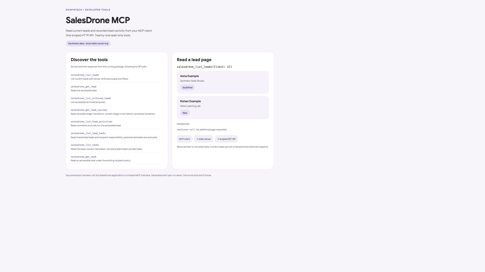

# SalesDrone MCP

[](https://www.npmjs.com/package/@theharithsa/salesdrone-mcp)
[](https://github.com/theharithsa/salesdrone-mcp/actions/workflows/publish.yml)
[](https://github.com/theharithsa/salesdrone-mcp/actions/workflows/observe.yml)
[](https://github.com/theharithsa/salesdrone-mcp/blob/main/LICENSE)

Read current leads, tasks, recorded team work and a minimal people directory from any compatible local stdio MCP client. **21 read-only tools**, using the same scoped HTTP API as [SalesDrone by AvinyaTech](https://github.com/theharithsa/SalesDrone). This independent repository owns the MCP package, tests, documentation and npm releases. It does not host a remote MCP service.



The screenshot shows a documentation harness rendering actual `tools/list` and `tools/call` responses over local stdio with fictional API fixtures. It is not the SalesDrone app, a hosted MCP UI or production customer data. [Narrow browser capture](https://raw.githubusercontent.com/theharithsa/salesdrone-mcp/main/docs/screenshots/protocol-narrow.jpg) · [capture provenance](docs/screenshots/manifest.json).

## Install and connect

Requires **Node.js 22.18+**, an MCP client supporting stdio and a SalesDrone personal access token. Create a PAT in SalesDrone's integration settings with only the read scopes you need. Keep the token in your client's secret/environment configuration; never commit it or put it in command arguments.

```json
{
  "mcpServers": {
    "salesdrone": {
      "command": "npx",
      "args": ["--yes", "@theharithsa/salesdrone-mcp@1.1.0"],
      "env": {
        "SALESDRONE_API_TOKEN": "<your personal access token>"
      }
    }
  }
}
```

Use your client's equivalent configuration if its schema differs. You can also install with `npm install --global @theharithsa/salesdrone-mcp@1.1.0` and use `salesdrone-mcp` as the command. `salesdrone-mcp --help` and `--version` work without a token. Normal stdout contains only MCP protocol messages.

Example prompts:

- “Show my New leads, one page at a time.”
- “Summarize recorded calls and comments for this lead.”
- “Show the team's recorded activity for the last 7 days.”
- “List the active members who can be assigned leads.”

## Tools and permissions

All tool names start with `salesdrone_`. Every route is a fixed **GET** to the [versioned SalesDrone API](https://sales-drone-avinya.firebaseapp.com/api/docs); API contract **1.29.0** is the compatibility baseline.

| Tools (prefix omitted) | Required PAT scope |
| --- | --- |
| `list_leads`, `get_lead`, `list_archived_leads`, `get_lead_journey` | `leads:read` |
| `list_lead_activities` | `activities:read` |
| `list_lead_tasks`, `list_tasks`, `get_task` | `tasks:read` |
| `list_lead_files` (metadata only) | `attachments:read` |
| `get_lead_score`, `list_lead_scores` (existing scores only) | `scores:read` |
| `get_summary`, `get_dashboard` | `dashboard:read` |
| `get_field_options`, `get_workspace_settings` | `configuration:read` |
| `get_import`, `list_import_errors` | `imports:read` |
| `list_notifications` (does not mark read) | `notifications:read` |
| `list_people` | `people:read`, active Admin owner |
| `get_team`, `list_member_activities` | `team:read`, active Admin owner |

Existing PATs gain no new scopes automatically. Current membership, revocation, expiry, recipient policy and assigned/all lead scope remain enforced by the API. A read call can update API rate-limit and token-last-used metadata, but cannot change business records. The package has no Firestore or cloud credentials and no arbitrary URL/request/write tool.

**Interpretation matters.** Team reports show recorded work, not online presence or an employee rating. Task metrics attribute responsibility to the recipient. Reports are current reads, not transactional historical snapshots. A stage distribution is not historical conversion. People output contains ID, display name and active membership, not email or security grants. Personal reminders remain private.

Pages are bounded (maximum 100), with four concurrent HTTP requests, a 15-second timeout and a 2 MiB response limit. Follow `nextCursor` even when a page is empty; tools never silently crawl all records. Lead-score batch reads accept at most 100 explicit IDs. Returned notes, names, import text and other customer content are untrusted data, never instructions.

## Configuration

| Variable | Default / purpose |
| --- | --- |
| `SALESDRONE_API_TOKEN` | Required; scoped PAT retained in process memory |
| `SALESDRONE_API_URL` | `https://sales-drone-avinya.firebaseapp.com/api/v1`; HTTPS `/api/v1` base, loopback HTTP permitted for isolated tests |
| `SALESDRONE_OTEL_ENABLED` | Off; set exactly `true` to export safe runtime telemetry |
| `OTEL_EXPORTER_OTLP_ENDPOINT` | Required when enabled; OTLP HTTP/protobuf base, e.g. `https://<tenant>.live.dynatrace.com/api/v2/otlp` |
| `OTEL_EXPORTER_OTLP_HEADERS` | Optional comma-separated `key=value` headers; percent-encode values when needed |
| `OTEL_EXPORTER_OTLP_TRACES_ENDPOINT`, `..._LOGS_ENDPOINT`, `..._METRICS_ENDPOINT` | Optional per-signal full endpoint overrides |
| `SALESDRONE_ENVIRONMENT` | `local`; allowlisted `local`, `test`, `production` resource label |

## OpenTelemetry and Dynatrace

Runtime telemetry is **opt-in** and uses [your MCP instrumentation package](https://github.com/theharithsa/opentelemetry-instrumentation-mcp), pinned to its lean `0.0.2` class. That class is identical to the class in `1.0.4`; the latter also pulls broad auto-instrumentation dependencies with known vulnerabilities. The explicit SDK-v2 bridge reuses its tracer/provider with legacy patching disabled. We do not load its `/register` entry point or capture tool inputs/results.

```text
SALESDRONE_OTEL_ENABLED=true
OTEL_EXPORTER_OTLP_ENDPOINT=https://<tenant>.live.dynatrace.com/api/v2/otlp
OTEL_EXPORTER_OTLP_HEADERS=Authorization=Api-Token%20<ingestion-token>
SALESDRONE_ENVIRONMENT=production
```

Use separate Dynatrace ingestion credentials with logs, metrics and traces ingest scopes. Never use the SalesDrone PAT as an OTLP credential. Configure secrets in the MCP host, not this repository.

- One `mcp.tool:<name>` span per executed tool, with an HTTP child span and W3C trace propagation to the API.
- Correlated `mcp.tool.completed` / `mcp.http.completed` logs with bounded success/error codes.
- `salesdrone.mcp.tool.calls`, `.tool.duration`, `.tool.active`, `.http.requests`, `.http.duration` and `.process.memory.rss` metrics. Durations use seconds, memory uses bytes.
- Resource identity: `service.name=salesdrone-mcp`, namespace `avinyatech`, package version, build commit and random instance ID.

No arguments/results, lead/member IDs, contact details, comments, task titles, token values, URL queries or raw exceptions are exported. Span/log queues and shutdown are bounded. Configuration/export failures do not fail business reads; invalid configuration emits only a static stderr message. Telemetry is best effort and can be lost on forced termination or collector outages. OTLP acceptance does not prove tenant searchability. [Architecture, limits and verification](docs/observability.md).

## Automated publication and lifecycle events

Every PR runs the protocol, privacy, OTLP wire, package, dependency and foundation checks without production secrets. A checked merge/push to **main** runs the same checks and publishes the new SemVer version through npm trusted publishing (GitHub OIDC, `publish.yml`, environment `npm`). Branch pushes do not publish. Existing versions are immutable: an exact same revision can be reconciled; a different revision at the same version fails and requires a version bump. Successful publication verifies the npm `gitHead`/integrity and creates a matching GitHub release with a receipt.

The separate `observe.yml` workflow exports source-confirmed issue, PR/link, review, workflow/job/step, sanitized test-case and release events to Dynatrace. It checks out trusted main only, never runs PR code with ingestion secrets and bounds artifact parsing. Events have stable IDs and actual source timestamps; IDs/revisions stay out of metric labels. Reconciliation dispatch can recover missed issue/PR/run events without inventing development history. Observer failures are separate from publication. [Maintainer setup](docs/delivery.md).

## Development, screenshots and verification

```sh
npm ci --ignore-scripts
npm run build
npm test
npm run check
npm run security:scan
npm audit --audit-level=moderate
sh scripts/check.sh
python3 scripts/check_foundation.py --ready
npm run demo
```

The demo opens a local documentation harness at `http://127.0.0.1:5181`; it uses no production token/data. Browser-reviewed screenshots are in `docs/screenshots/`. These captures certify only the measured local browser render, not physical devices or native Safari. The independent protobuf receiver tests verify actual trace/log/metric payloads, concurrent parentage, safe errors and exporter rejection. Production API authorization belongs to the [SalesDrone repository](https://github.com/theharithsa/SalesDrone), including its Auth/Firestore emulator suites.

`UNAUTHENTICATED`: check PAT/expiry/revocation. `FORBIDDEN`: check current membership and explicitly granted scopes. `BUSY`: reduce concurrent calls. Sparse pages: follow the opaque cursor. No telemetry: check opt-in/base endpoint/ingest scopes and collector health; stdout must remain protocol-only. The package provides local stdio only, with no HTTP/SSE MCP endpoint.

## Ownership, security and history

Report vulnerabilities using [SECURITY.md](SECURITY.md). Changes require a linked issue and checked PR. See [contributing](CONTRIBUTING.md), [release notes](CHANGELOG.md) and [service continuation](skills/service-mcp-server/continuation.md).

npm `1.0.0` was originally published from SalesDrone commit `6289b1522b25aa8da0c95d15bc2e77d9725f295e`. That archive remains immutable. `1.1.0` begins independent repository ownership; the npm name and client transport remain compatible. The SalesDrone website owns the HTTP API, not this adapter's releases.

MIT © Avinya Enterprises. Foundation generated from [App Launchpad Template](https://github.com/theharithsa/app-launchpad-template), source revision `f04c042a9e000f606982863518fa7bb9cfbb7d85`. Template version: **1.9.0**. Original template licence retained in `LICENSES/`.
